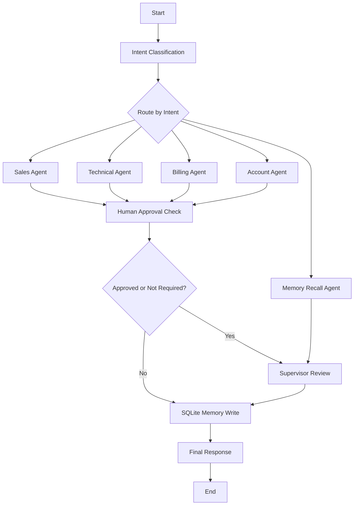

# AI-Powered Customer Support Automation System

This is a complete local Python project for a customer support automation assignment using LangGraph, LangChain, Ollama, RAG, and SQLite memory.

It does not use OpenAI, paid APIs, or API keys.

## Environment

- Python 3.11
- Windows
- Ollama installed locally
- Ollama model: `llama3.1:latest`
- SQLite local memory database

## Setup

From this project folder:

```powershell
python -m venv .venv
.\.venv\Scripts\activate
pip install -r requirements.txt
ollama pull llama3.1:latest
python main.py
```

The database file is created automatically at:

```text
database/memory.db
```

The sample knowledge base documents are included in:

```text
docs/
```

## Demo Queries

`main.py` automatically runs these five required queries:

1. What are the pricing plans available for your software?
2. I forgot my account password.
3. My application crashes whenever I upload a file.
4. I need a refund for my annual subscription.
5. What was my previous support issue?

The fourth query requires human approval. When prompted:

```text
Approve request? (y/n):
```

Type `y` to approve or `n` to reject.

## Project Structure

```text
customer_support_ai/
  main.py
  requirements.txt
  README.md
  agents/
    support_agents.py
  graph/
    state.py
    workflow.py
  memory/
    sqlite_memory.py
  rag/
    retriever.py
  docs/
    company_policy.txt
    pricing_guide.txt
    technical_manual.txt
    faq.txt
  database/
    memory.db
```

## LangGraph Workflow



## What Each Component Does

- `graph/state.py` defines the `TypedDict` state used by LangGraph.
- `graph/workflow.py` builds the LangGraph workflow, conditional routing, approval pause, supervisor review, and memory write step.
- `agents/support_agents.py` calls local Ollama through `langchain-ollama`.
- `rag/retriever.py` loads local company documents with LangChain document loaders and retrieves relevant context with a small local vector store.
- `memory/sqlite_memory.py` creates and manages SQLite support memory.

## Notes

If Ollama is not running, the app still prints a fallback response so the workflow can be demonstrated. For full LLM output, make sure Ollama is running and the `llama3.1:latest` model is available.
